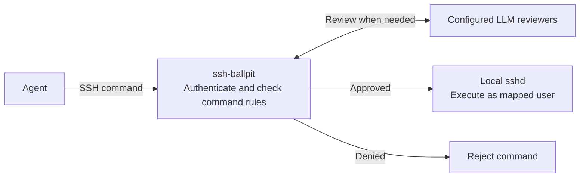

# ssh-ballpit

[](https://github.com/dlotterman/ssh-ballpit/actions/workflows/ci.yml)
[](https://github.com/dlotterman/ssh-ballpit/actions/workflows/ci.yml)

Intercept and review SSH commands for safety by multiple LLMs.

## Motivation

The author's environment has four types of computers:

- Human workstations with broad access to the network.
- Ollama hosts with accelerators running local models.
- An isolated machine for third-party agents such as Codex and Claude, with
  internet access but limited access to the local network.
- Target machines: lab computers, Raspberry Pis, VMs and containers.

Sometimes an agent needs access to a target machine without a human approving
individual commands. `ssh-ballpit` is the resulting experiment: an SSH gateway
that asks configured LLMs to review commands before forwarding them to sshd.

The original goal was supervision by a locally hosted, open-weight model.
Additional providers can add independent reviews when the local model misses
something.



The [connection flow](docs/connection-flow.md) describes authentication, command
decisions, execution and exit statuses in detail.

### Production

This is a personal experiment, shared for the sake of sharing. It is not ready
for production or dependable lab use.

You break it you buy it.

## Run

### Set up once

From the directory where you want to keep configuration, create a private bind
mount and use the published [Docker Hub image](https://hub.docker.com/r/dlotterman/ssh-ballpit)
to generate starter files:

```sh
install -d -m 700 config
podman run --pull=always --rm --userns=keep-id \
  -v "$PWD/config:/config:z" \
  docker.io/dlotterman/ssh-ballpit:latest configure
```

Edit `config/server.yaml` with your SSH username and client key fingerprint.
Put these files in `config/`:

- `authorized_keys`: client public keys permitted to use the gateway.
- `backend_key`: private key already accepted by your local sshd; use mode `0600`.
- `known_hosts`: verified host key for your local sshd.

`configure` also creates example [whitelist and blacklist rules](docs/command-rules.md).
Edit or remove either file before starting the gateway.

### Providers

`configure` creates `config/providers/ollama.yaml`. Edit it or copy other
[`provider examples`](examples/providers) into `config/providers/`.
**Every `.yaml` or `.yml` file there is required to approve each command that
reaches model review.** Remove a file to disable that reviewer.

Ollama's endpoint URL lives in `ollama.yaml`. API providers have an `api_key` field.
For OpenAI subscription access, copy `openai-subscription.yaml` and register once:

```sh
podman run --rm -it --userns=keep-id -v "$PWD/config:/config:z" \
  docker.io/dlotterman/ssh-ballpit:latest login-openai
```

Enter the printed one-time code at the URL on another device. Login state is
saved in `config/state/codex` and reused by the daemon and host binary.

### Start gateway

```sh
podman run --rm --name ssh-ballpit --userns=keep-id --network=host \
  -v "$PWD/config:/config:z" docker.io/dlotterman/ssh-ballpit:latest
```

```sh
ssh -T -p 2222 alice@127.0.0.1 'uname -a'
```

The gateway host key is generated once in `config/state/host_key`. Provider and
command-rule files are read at startup; restart after editing them. The default
listener is local only; change `listen` in `server.yaml` to accept remote clients.

These commands use rootless Podman on Linux. The single bind mount keeps
configuration, SSH keys and login state on your host. LLM review is a heuristic,
not a sandbox; direct connections to the existing sshd bypass review.

Optional [lab key discovery](docs/configuration.md#lab-key-discovery) and
[Prometheus metrics](docs/configuration.md#prometheus-metrics) are configured in `server.yaml`.

[Configuration and troubleshooting](docs/configuration.md)

## License & Contributing

[The Unlicense](LICENSE) applies only to the original ssh-ballpit code,
configuration, documentation and packaging in this repository. It does not
relicense third-party software imported by the application or bundled in its
container. Those components retain their own licenses, copyrights and notices.

The imported Go software includes **Apache-2.0, BSD-3-Clause and MIT** licenses;
the wider selected module graph also includes **ISC**. These are licenses of
different components or files, not a choice of license for the whole application.
The container additionally includes Codex, Node.js, npm and Debian packages.
Their license metadata and bundled notices include **Artistic-2.0, BSD-2-Clause,
GPL, LGPL, MPL-2.0 and Zlib**, among others. Codex's own Apache-2.0 license does
not cover all of its bundled native libraries; the SBOM lists those separately.

See [`sbom.md`](sbom.md) for exact versions, dependency scope, license evidence,
the runtime container inventory, and regeneration instructions. Retain applicable
upstream license and NOTICE files when redistributing third-party components.

This project is "vibe-coded". Instead of accepting contributions, the author
encourages you to fork it or build your own.
