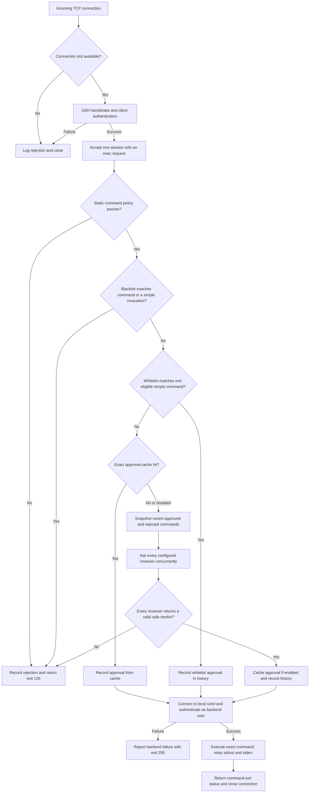

# Connection and command flow

ssh-ballpit terminates the client's SSH connection, reviews the requested command,
and opens a separate SSH connection to the host's existing sshd only after approval.
It handles one command per connection. It is not an interactive shell or a
ProxyJump relay, and it does not change the existing sshd configuration.

For example:

```sh
ssh -T -i ~/.ssh/id_ed25519 -p 2222 system_user@gateway.example.net 'uptime'
```

Use single quotes around the remote command. Backticks execute the command on the
client first and send its output instead.

## At a glance



Unsupported SSH channels and requests are rejected before command processing.
The listener continues accepting new connections while each admitted connection
runs through its own handler.

## 1. Load configuration and start listening

At startup the daemon reads server and provider configuration, validates and
compiles optional `whitelist.yaml` and `blacklist.yaml` command rules, loads client key
rules, loads or creates its own SSH host key, and loads the backend private key
and host-key trust file. The backend must be a literal loopback address, such as
`127.0.0.1:22`. It logs configuration without credentials, starts the SSH listener,
and starts the optional Prometheus listener.

One shared approval cache and recent-history store are created for the daemon.
They live in memory and are cleared on restart. Configuration changes also
require a restart.

## 2. Admit and authenticate the client

The accept loop checks `max_connections` (default 32). If all slots are occupied,
it logs the rejection and closes the new connection. Otherwise, a separate handler
gets a slot and has 10 seconds to complete the SSH handshake.

The client authenticates to **ssh-ballpit**, using its public key. In normal mode:

- The frontend username must exist in `users` and have a `backend_user` mapping.
- The key must appear in the configured `authorized_keys` file.
- Its fingerprint must also appear in that user's `fingerprints` list.
- The client must prove possession of the corresponding private key.

`accept_all_keys: true` bypasses the two key allowlists for mapped users. It still
requires proof of private-key possession. Bypassed authorization is logged at
ERROR level, including the public key and fingerprint after successful authentication.
An unsigned key offer is not a successful login.

After authentication, `session_seconds` (default 300) bounds the remaining session,
including review and execution. A disconnect or daemon shutdown cancels its work.

## 3. Receive one command

The handler permits one SSH `session` channel and an `exec` request. It rejects
forwarding channels and requests such as PTY allocation, interactive shell,
subsystem, and environment requests. This also excludes SFTP and ProxyJump use.

The daemon decodes the command and calculates its SHA256 hash for logs. If
`log_commands: true`, it also logs the plaintext command. Accepting the SSH `exec`
request acknowledges receipt; it does not mean the command passed review.

## 4. Apply the static policy

Before consulting the cache or any model, the daemon parses the command as shell
syntax. It rejects empty commands, NUL bytes, commands over 16,384 bytes, and
unsupported syntax. It also blocks command/process substitutions and selected
entry points such as shells, interpreters, `sudo`, `ssh`, and `eval`. Executable
names containing a slash or requiring expansion are rejected too.

A static rejection is recorded in rejected history as `static_policy`. The client
receives a reason and exit status **126**. An LLM cannot override this rejection.
The exact policy is implemented in [`policy`](../cmd/ssh-ballpit/policy.go).

## 5. Apply command blacklist and whitelist rules

The daemon checks the [command rules](command-rules.md)
loaded from the configuration directory. Regexes match the whole command;
blacklist checks also inspect individual simple invocations inside lists and
pipelines. A blacklist match records a rejection with source `blacklist` and
returns **126**, before any cache lookup or model call.

Otherwise, a whitelist match on one eligible simple command records approval
with source `whitelist` and proceeds directly to backend execution. Wildcard
matches cannot skip review for appended commands, redirections, assignments or
shell expansions other than pathname globs. Whitelist approvals do not enter
the approval cache. Both lists are optional; unmatched commands continue below.

## 6. Check the approval cache

The cache key includes the frontend username, backend username, and exact command
bytes. Whitespace changes or a different user mapping produce a different key.
Only unanimously approved commands are cached; rejections and errors are not.

On a hit, no model is called. The command is recorded in approved history with
source `approval_cache`, then proceeds to backend execution. Static policy and
blacklist checks still run, and backend authentication and host-key checks still apply.

The default capacity is 10,000 entries, with least-recently-used eviction.
`approval_cache_entries: -1` disables it. Cached approval has no time-based expiry
and does not account for changed files, URL contents, or other external state.
Changing recent history does not invalidate a cached decision.

## 7. Review a cache miss with every provider

The daemon takes a snapshot of the last five approved and last five rejected
commands for the frontend/backend user pair. Each list is oldest first. All
reviewers receive the same snapshot, the current command, and the backend username.
History is context, not automatic permission or an instruction to the model.

Provider requests are launched concurrently and share a `review_seconds` deadline
(default 30 seconds), within the overall session deadline. The daemon waits for
all results; it does not stop after the first approval or rejection. Subscription
requests may also wait for their provider's serialized access.

Each reviewer checks offensive language, command intent, destructive operations,
privilege/access expansion, and download/package destinations. Its response must
provide the four required fields: `offensive`, `danger_score`, `reasons`, and
`destinations`. A reviewer approves only if:

- The verdict passes strict JSON, field, and type validation.
- `offensive` is `false`.
- `danger_score` is strictly **less than** that provider's threshold.

For Ollama-compatible responses, a single complete Markdown JSON fence can be
removed before the same strict validation. Arbitrary prose is not extracted.
Gemini 503 errors can be retried twice within the existing deadline. Other HTTP
errors and malformed verdicts are not automatically retried.

Every configured provider must approve. A timeout, transport error, invalid
response, offensive verdict, or score at/above threshold denies the command.
The client receives `denied: every configured reviewer must approve` and exit
status **126**; per-provider details are available in the daemon logs.

The completed decision enters history before backend execution. Valid safety
rejections use source `reviewers`; a denial caused only by review failures uses
`review_error`. Unanimous approval is cached if enabled and recorded as approved,
even if execution later fails. Concurrent in-flight reviews are not in history
until they finish.

## 8. Open a separate connection to local sshd

Only after approval does ssh-ballpit connect to `backend`. It checks the server's
host key against `known_hosts` and authenticates as `backend_user` using
`backend_key`. The client's private key is never forwarded. The backend account
must already authorize the daemon's backend key.

With `accept_all_keys: true`, unknown, changed, or revoked backend host keys are
accepted and logged at ERROR level with their fingerprint and a `known_hosts_entry`.
SSH still verifies possession of the host private key, and backend user
authentication remains required. See [lab key discovery](configuration.md#lab-key-discovery).

## 9. Execute, relay results, and release the slot

The daemon sends the exact approved command in a backend SSH exec request.
Backend stdin is EOF: client input is not forwarded as an unchecked program.
Stdout and stderr are relayed to the original client. Output is not reviewed by
the LLMs, and execution is not continuously supervised by them.

Normal completion returns the backend command's exit status. Backend connection,
authentication, or session failures return **255** with a generic client error
and a more specific daemon log. The channel and connection close, active
connection metrics decrease, and the slot is released for another client.

## What to look for in logs

| Event | Meaning |
| --- | --- |
| `ssh authentication succeeded` | Client authenticated to the gateway; no command approval yet. |
| `command policy` | Final static-policy, blacklist, or whitelist decision; includes source, safety and command hash. |
| `approval cache` | Whether the command reused a previous approval and whether it is allowed. |
| `review` | A provider's result on a cache miss; `safe: false` with an error indicates a review failure. |
| `provider review diagnostic` | Opt-in detailed provider diagnostics, including Ollama curl replay. |
| `ssh untrusted backend host key accepted` | Lab mode bypassed a host-key trust failure; this is not a connection failure. |
| `backend failed` | Review passed, but backend connection or execution failed. |

[Verbose diagnostics](configuration.md#verbose-provider-diagnostics) can include
plaintext commands, recent history, and response excerpts. Prometheus exposes
connection, review, cache, and execution statistics without command text.

The daemon makes automated admission decisions, not a sandbox guarantee. Direct
access to the host's existing sshd bypasses these checks, so the surrounding
network and account access rules remain part of the deployment.
